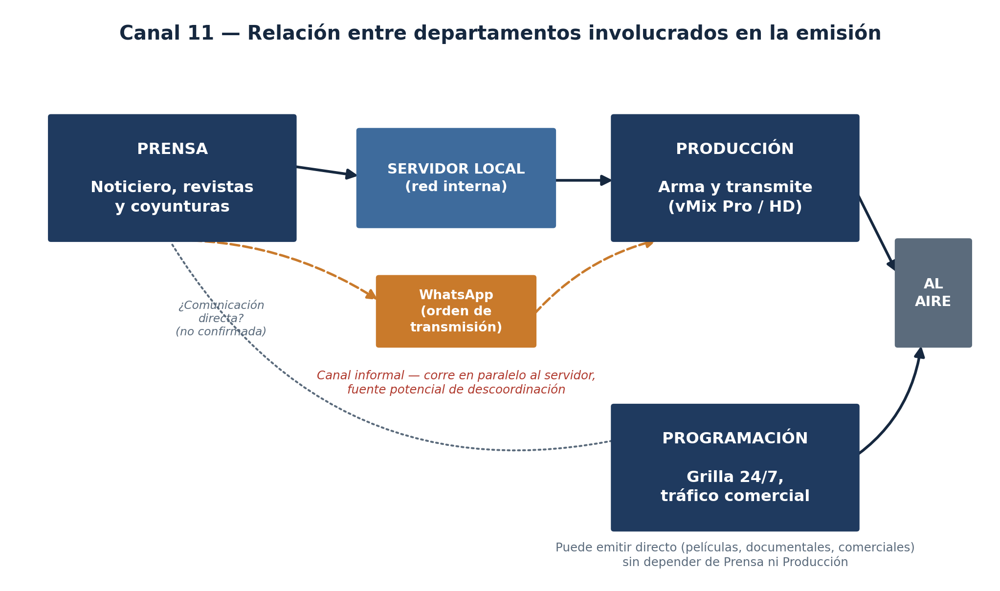
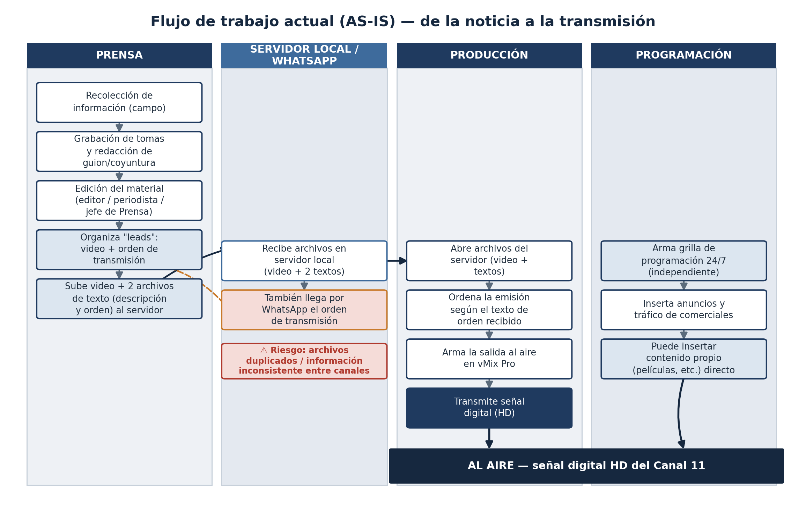
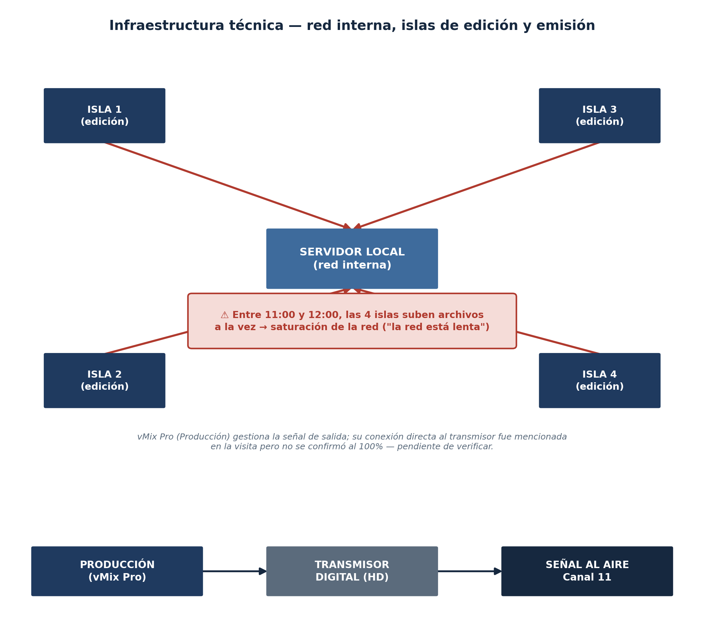

# Canal 11 — Levantamiento de Información

### Flujo de trabajo entre Prensa, Producción y Programación, e infraestructura técnica asociada

**Documento de análisis de la situación actual (AS-IS)**
Preparado para el equipo de desarrollo de software
Materia: Tecnología Web (INF513) — Proyecto 1, Gestión II/2026
Fuente: entrevista con el director del canal y visita técnica en sitio
Santa Cruz de la Sierra, Bolivia — Septiembre de 2026

---

## 1. Introducción y propósito del documento

Este documento presenta el resultado del levantamiento de información realizado en Canal 11 con el objetivo de comprender, describir y documentar de forma estructurada el flujo de trabajo actual entre los tres departamentos involucrados en la generación y emisión de contenidos: Prensa, Producción y Programación. La información se obtuvo a partir de una entrevista directa con el director del canal y de una visita técnica en sitio, en la que se observó el funcionamiento real de los equipos de edición, el servidor local y el software de emisión.

El propósito central es dejar constancia clara, verificable y visual de la situación actual ("As-Is") del proceso, de manera que un equipo de software que no participó en las entrevistas pueda comprender rápidamente cómo opera hoy el canal, qué información se mueve entre las áreas, qué tecnología ya existe, y —lo más importante— dónde se originan los problemas de comunicación y coordinación que el director identificó como la principal dificultad a resolver.

Este documento no define aún objetivos, alcance ni arquitectura de una posible solución de software: se limita a describir la realidad operativa observada, de forma que sirva como base sólida y compartida para la etapa de análisis y diseño posterior.

## 2. Fuentes y metodología de recolección de información

La información documentada en este informe proviene de dos fuentes complementarias:

- **Entrevista con el director del canal** — conversación abierta en la que se explicó, en sus propias palabras, la función de cada departamento, el flujo documental entre ellos y los principales problemas percibidos.
- **Visita técnica en sitio** — recorrido grabado (audio transcrito) por las instalaciones de edición y transmisión, en el que se observó directamente el uso del servidor local, el software de emisión y la infraestructura de red, y se conversó con personal técnico sobre su funcionamiento cotidiano.

Ambas fuentes fueron transcritas y depuradas manualmente: el audio de la visita técnica se grabó frente a una pantalla con noticias al aire, por lo que el contenido informativo de fondo (notas de prensa que se estaban transmitiendo en ese momento) fue identificado y descartado por no ser información relevante para el levantamiento.

> **Nota sobre el alcance de la información.** Algunos detalles quedaron sin confirmar al 100% durante la recolección (por ejemplo, si el software de emisión se conecta directamente al transmisor, o si existe comunicación directa entre Programación y Prensa). Estos puntos se señalan explícitamente en el documento como pendientes de verificación, en lugar de asumirse.

## 3. Estructura organizacional del flujo de contenidos

Canal 11 organiza la producción y emisión de su noticiero y contenidos asociados a través de tres departamentos con responsabilidades claramente diferenciadas. El siguiente diagrama resume cómo se relacionan entre sí, incluyendo el canal de comunicación informal (WhatsApp) detectado durante la visita técnica.

*Figura 1. Relación entre Prensa, Producción y Programación en el flujo de emisión de Canal 11.*

| Departamento | Función principal | Entradas / Salidas | Observaciones |
|---|---|---|---|
| **Prensa** | Recolectar información, grabar, redactar y editar las notas del noticiero y revistas. | Entrada: hechos noticiosos (campo). Salida: video + 2 archivos de texto (descripción y orden). | Solo cubre el noticiero de Canal 11; no otros contenidos del canal. |
| **Producción** | Tomar el material recibido de Prensa y armar/transmitir la emisión. | Entrada: archivos del servidor local de Prensa. Salida: señal digital HD al aire. | Usa vMix Pro para armar la salida al aire. |
| **Programación** | Armar la grilla de emisión 24/7, incluyendo publicidad y contenido propio. | Entrada: ninguna de Prensa/Producción (opera de forma independiente). Salida: contenido directo al aire. | Puede emitir películas, documentales o comerciales sin depender de los otros dos departamentos. |

## 4. Descripción detallada por departamento

### 4.1 Prensa

El departamento de Prensa es responsable exclusivamente del noticiero de Canal 11 (noticias y revistas); no interviene en otros contenidos del canal. Su trabajo abarca todo el ciclo de producción de una nota periodística, desde la recolección de la información hasta la entrega del material terminado.

Roles involucrados: periodistas, editores de video y el jefe del departamento de Prensa, quien aprueba el material antes de su entrega.

**Actividades principales**

- Recolección de información y trabajo de campo (entrevistas, cobertura de hechos).
- Grabación de tomas y videos en el lugar de los hechos.
- Redacción de guiones y "coyunturas" (contextualización de la noticia).
- Edición del material propio, con revisión de editores y periodistas.
- Organización de los "leads" o notas de prensa: a cada nota se le asigna un orden (por ejemplo, "lead 1 / video 1").

**Producto final entregado**

Una vez aprobado el material, Prensa sube el contenido a un servidor local propio mediante la red interna del canal. Cada video terminado se acompaña de dos archivos de texto adicionales:

- **Descripción** — de qué trata la nota o noticia.
- **Orden de transmisión** — la secuencia en la que las notas deben salir al aire.

Adicionalmente, se detectó en la visita técnica que el texto con el orden de transmisión también se envía por WhatsApp, en paralelo a la subida al servidor (ver sección 6.3).

### 4.2 Producción

Producción recibe del servidor local los archivos que sube Prensa —videos, descripciones y orden de transmisión— y es responsable de armar la emisión y ponerla al aire.

**Actividades principales**

- Abrir y revisar los archivos recibidos del servidor (video + textos).
- Ordenar la emisión según el texto de orden de transmisión recibido.
- Armar la salida al aire utilizando el software vMix Pro.
- Transmitir la señal, actualmente en formato digital HD (el canal migró de señal analógica a un transmisor HD).

Prensa y Producción están directamente conectados en el flujo de trabajo: todo lo que Producción transmite del noticiero proviene del material que Prensa sube al servidor.

### 4.3 Programación

Programación arma la grilla de emisión que se transmite las 24 horas, los 7 días de la semana, incluyendo publicidad y tráfico comercial.

**Actividades principales**

- Definir la grilla general de programación (qué se transmite y durante cuánto tiempo).
- Insertar anuncios y tráfico de comerciales.
- Insertar contenido propio de forma directa (películas, documentales, comerciales) sin pasar por Prensa ni por Producción.

A diferencia de Producción, Programación no depende del material de Prensa: opera con su propia grilla y puede emitir contenido de forma independiente. Durante la entrevista no quedó confirmado si existe comunicación directa y sistemática entre Programación y Prensa; el director expresó dudas al respecto ("creo que no").

## 5. Flujo de trabajo actual (AS-IS): de la noticia a la transmisión

El siguiente diagrama de carriles (swimlane) integra la información de los tres departamentos y muestra, paso a paso, cómo una noticia recorre el proceso completo hasta salir al aire, incluyendo el punto donde se identificó el principal riesgo de descoordinación.

*Figura 2. Diagrama de flujo (AS-IS) del proceso completo, desde la recolección de la noticia hasta la transmisión al aire.*

**Lectura del flujo**

- Prensa recolecta, graba, redacta y edita la nota; al finalizar, organiza el "lead" (video + orden) y sube ambos archivos de texto junto con el video al servidor local.
- En paralelo, el orden de transmisión también se comparte por WhatsApp — un canal informal que corre junto al canal formal (servidor).
- Producción abre los archivos del servidor, ordena la emisión según el texto recibido, arma la salida en vMix Pro y transmite en señal digital HD.
- Programación opera en un carril aparte: arma su propia grilla 24/7, inserta publicidad, y puede insertar contenido directo al aire sin pasar por Prensa ni por Producción.
- **Punto crítico:** al existir dos canales para comunicar el orden de transmisión (servidor y WhatsApp), se genera un riesgo real de archivos duplicados o información inconsistente entre lo que Producción lee de uno u otro canal (ver sección 7).

## 6. Infraestructura técnica

### 6.1 Servidor local y red interna

Prensa y Producción comparten un servidor local, accesible a través de una red interna propia del canal. Es el canal formal mediante el cual se entregan los videos terminados junto con sus dos archivos de texto asociados (descripción y orden de transmisión).

### 6.2 Islas de edición y saturación de la red

Durante la visita técnica se identificaron cuatro estaciones de edición, llamadas "islas", conectadas a la misma red interna que da servicio al servidor local. Se observó que, en el rango horario entre las 11:00 y las 12:00, las cuatro islas trabajan y suben archivos de forma simultánea, lo que satura la red y hace que el sistema se perciba como lento ("la red está lenta", según el personal técnico consultado).

*Figura 3. Infraestructura de red interna: las 4 islas de edición, el servidor local y la cadena de emisión (Producción → Transmisor → Al aire).*

> **Hallazgo técnico relevante.** La saturación de red observada entre las 11:00 y las 12:00 no es un problema de comunicación entre personas, sino un cuello de botella de infraestructura que se suma —y probablemente agrava— el problema de coordinación entre departamentos, ya que retrasa la disponibilidad de los archivos que Producción necesita leer del servidor.

### 6.3 Canal informal: WhatsApp

Además de subir el video y los dos archivos de texto al servidor, Prensa envía el texto con el orden de transmisión también por WhatsApp. Este canal informal corre en paralelo al canal formal (servidor/red interna) y fue señalado en la visita técnica como una práctica habitual del equipo.

Este hallazgo es relevante porque introduce una segunda fuente de verdad para un mismo dato (el orden de transmisión), lo que puede provocar inconsistencias si ambos canales no siempre coinciden o no se actualizan al mismo tiempo.

### 6.4 Software de emisión: vMix Pro

Producción utiliza vMix Pro, un software de emisión con licencia comprada, descrito por el personal como "uno de los mejores programas para poder trabajar". Se menciona que este programa está conectado al transmisor, aunque este punto específico no quedó confirmado con total claridad en el audio de la visita y se recomienda validarlo antes de tomar decisiones de diseño que dependan de ello.

## 7. Problemas identificados

La siguiente tabla consolida, en orden de relevancia según lo expresado por el director, los problemas detectados durante el levantamiento. Se incluye la evidencia que los respalda y el área del proceso a la que afectan, como insumo directo para la etapa de definición del problema y objetivos del proyecto.

| # | Problema identificado | Evidencia / origen | Área afectada | Impacto potencial |
|---|---|---|---|---|
| 1 | Comunicación deficiente entre departamentos | Señalado explícitamente por el director como el principal problema del canal. | Prensa ↔ Producción ↔ Programación | Retrasos, confusión operativa, pérdida de trazabilidad. |
| 2 | Archivos repetidos / duplicados | Ejemplo concreto mencionado por el director al describir el problema de comunicación. | Servidor local / Producción | Confusión sobre qué versión transmitir; posible reproceso. |
| 3 | Canal informal (WhatsApp) paralelo al canal formal | Observado en la visita técnica: el orden de transmisión se envía tanto al servidor como por WhatsApp. | Prensa → Producción | Doble fuente de verdad; riesgo de inconsistencia en el orden de transmisión. |
| 4 | Saturación de la red interna (11:00–12:00) | Observación directa del personal técnico durante la visita: las 4 islas suben archivos a la vez. | Red interna / Servidor local | Lentitud percibida, posibles retrasos en la disponibilidad de archivos para Producción. |
| 5 | Relación Programación–Prensa no confirmada | El propio director expresó incertidumbre ("creo que no") sobre si existe comunicación directa. | Programación ↔ Prensa | Posible falta de alineación entre la grilla general y el contenido noticioso. |

**Fuera de alcance (mencionados, pero no forman parte de este levantamiento)**

Durante la entrevista se mencionaron adicionalmente dos limitaciones de equipamiento: las máquinas de edición de Prensa no son ideales para el trabajo de video, y el departamento no cuenta con cámaras propias adecuadas. El propio usuario que condujo el levantamiento indicó explícitamente que estos dos puntos no forman parte del alcance de este análisis, por lo que se dejan registrados aquí únicamente a modo de contexto.

## 8. Glosario de términos

| Término | Significado en el contexto de Canal 11 |
|---|---|
| Lead | Nombre que usa Prensa para referirse a una nota de prensa organizada (ej. "lead 1 / video 1"), con su video y su orden asociados. |
| Coyuntura | Texto de contextualización que acompaña una nota periodística. |
| Isla | Estación de trabajo de edición de video; el canal cuenta con 4, conectadas a la misma red interna. |
| Grilla | Programación general de emisión que arma el departamento de Programación para transmitir 24/7. |
| Servidor local | Servidor propio del canal, accesible por red interna, donde Prensa sube el material terminado (video + textos) para que Producción lo use. |
| vMix Pro | Software de emisión con licencia comprada que usa Producción para armar y transmitir la señal al aire. |

## 9. Fuentes de este documento

- Entrevista con el director de Canal 11 (transcripción y notas del levantamiento inicial).
- Visita técnica en sitio, con recorrido por las áreas de edición y transmisión (audio transcrito automáticamente y depurado por el equipo).

Todas las citas textuales incluidas en este documento (por ejemplo, "la red está lenta" o "creo que no") provienen directamente de estas dos fuentes y se mantienen entre comillas para distinguir la observación directa de la interpretación del equipo.
